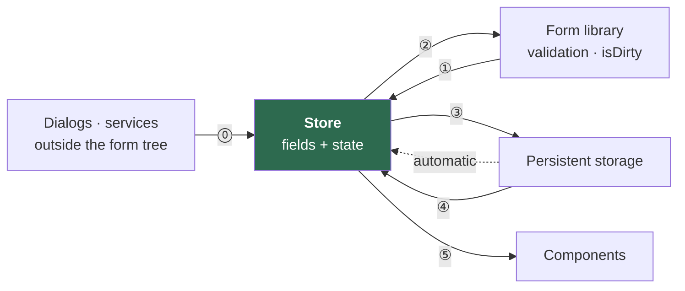
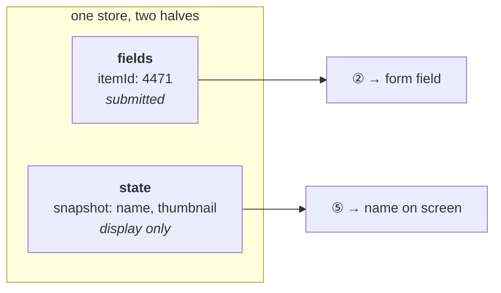
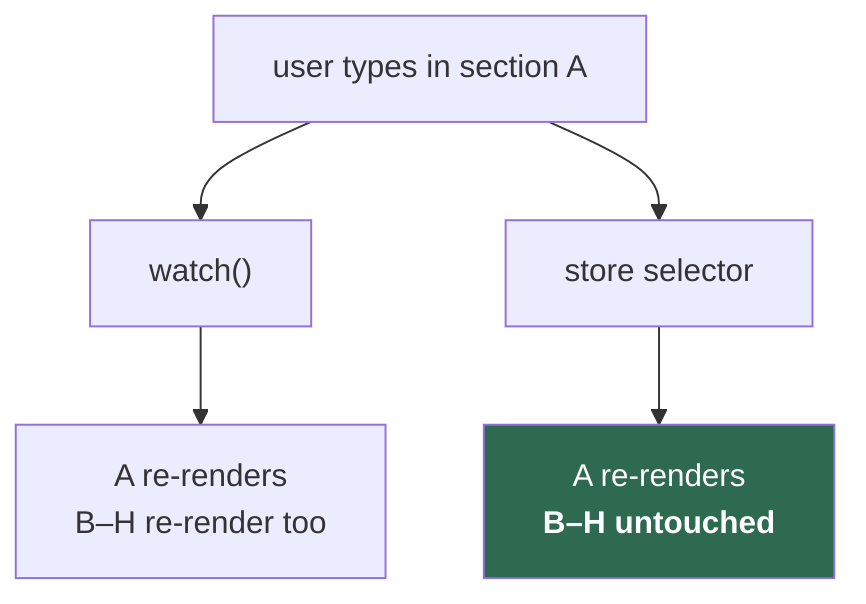

# Keeping a Form, a Store, and Storage in Sync

An admin console with twenty long forms needs three parties kept in sync: the **form library** (user input, validation, `isDirty`), a **store** (the fields, plus everything the form has no room for), and **persistent storage** (drafts that survive a refresh or a second tab). The sync between them is four arrows — ①–④ in the diagram below.

This document is the nine ways they break first, then the one hook that closes them, and last why the architecture needs these three parties at all.



⓪ direct write · ① `syncFormToStore` · ② `syncStoreToForm` · ③ persist middleware · ④ `rehydrateOnTabFocus` · ⑤ selector subscription. The dotted arrow is the middleware hydrating once at store creation — automatic, and never again.

⓪ (whatever calls `setState`) and ⑤ (ordinary selector subscription) need no synchronizing, and ③ is middleware the hook only switches on and off. The three the hook actually owns — `syncFormToStore` (①), `syncStoreToForm` (②), `rehydrateOnTabFocus` (④) — are named as in [`reference/create-form-store-helper.ts`](reference/create-form-store-helper.ts).

---

## The nine ways it breaks

Those four arrows are not four lines of code, because each one has a way of going wrong that produces no error.

| # | Difficulty | What it looks like when it bites | How it's resolved |
|---|---|---|---|
| 1 | Two owners of one value | Infinite loop: form writes store, store writes form, repeat | ① ② guard with `deepEqual`, skip unchanged writes — stops after one hop |
| 2 | `subscribe` is change-only | Empty form over a valid draft — the value was already correct, so no change ever fires | ② pulls once by hand at mount, before subscribing |
| 3 | `reset` is being used as transport | Unsaved-changes warning silently disarmed on every store push | Every store→form push keeps `keepDirty` |
| 4 | Storage never announces itself | Second tab stale forever; the browser fires `storage`, the middleware never listens | ④ calls `rehydrate()` on focus — the read the middleware skips |
| 5 | Remote data arrives more than once | Focus revalidation replaces the store and destroys in-flight edits | Initializer applies the first server DTO only (`useRef` flag) |
| 6 | Programmatic writes look like user writes | A brand-new create page stamps a draft the user never typed | Writes go store-first (② delivers, ① stays silent); create page discards a stale draft |
| 7 | One key, many records | Record #1's content appears in record #2's form, across tabs | Opt-in `skipPersist` swaps in noop storage |
| 8 | The store is a module singleton | Two mounted forms fight over `reset`; stale `isDirty` leaks across routes | Dev-only guard `console.error`s on a second mount, compiled out of prod |
| 9 | Reference equality is not value equality | Object fields with identical content trigger spurious resets | Guards compare by value (`deepEqual`), not `===` |

None of these throw. Every one of them ships.

---

## The tool

A single hook closes difficulties 1, 2, 3, 4 and 9, turns 8 into a dev-time error, and offers an opt-in flag for 7 — hold that one lightly; the last section is about how that flag went. Below is the hook with types simplified. The production version, including the initializer that handles 5 and 6, is [`reference/create-form-store-helper.ts`](reference/create-form-store-helper.ts).

### The shape

Two layers: the factory runs once per store at module load; the hook it returns runs per mount. The hook *is* the four arrows — four effects, one per arrow, listed in the order the production file runs them. Both vertical pairs are asymmetric the same way: the downward edge is automatic (① every keystroke, ③ every write), the upward edge has to be asked for (② a pull at mount, ④ only when something calls it). The rest of this section is the body of each one, declared inside the hook so it closes over `form`, `store` and `skipPersist`.

```ts
export const createFormStoreSync = (store: PersistedStore) => {
  const originalStorage = store.persist.getOptions().storage   // read once, here — see ③
  let activeMountCount = 0                                      // see difficulty 8

  return function useFormStoreSync(form: FormApi, { skipPersist = false } = {}) {
    useEffect(suppressPersistStorage, [skipPersist])        // ③ S → P   on/off only; the middleware writes
    useEffect(rehydrateOnTabFocus,    [form, skipPersist])  // ④ P → S
    useEffect(syncFormToStore,        [form])               // ① F → S
    useEffect(syncStoreToForm,        [form])               // ② S → F
  }
}
```

### What the code assumes

```ts
type FormDto = { fields: object; state: object }      // the two halves — see "Why three parties"

type FormApi = {                                      // the three React Hook Form methods used
  getValues(): FormDto['fields']
  reset(values: FormDto['fields'], options?: { keepDirty?: boolean; keepErrors?: boolean }): void
  subscribe(options: { formState: { values: true }; callback: (state: { values: FormDto['fields'] }) => void }): () => void
}

type PersistedStore = StoreApi<FormDto> & {           // zustand's StoreApi + what the persist middleware adds
  persist: {
    rehydrate(): Promise<void>
    getOptions(): { storage: Storage }
    setOptions(options: { storage: Storage }): void
  }
}

declare const deepEqual: (a: unknown, b: unknown) => boolean   // structural — difficulty 9 is about `===`
const noopStorage = { getItem: () => null, setItem: () => {}, removeItem: () => {} }
```

### ① `syncFormToStore` — every keystroke, one direction

```ts
function syncFormToStore() {
  return form.subscribe({
    formState: { values: true },
    callback: ({ values }) => {
      // Difficulty 1 (two owners) + 9 (reference equality): compare by value against the
      // *live* store, not a closed-over snapshot, and refuse to write when nothing changed.
      if (deepEqual(values, store.getState().fields)) return
      store.setState(prev => ({ ...prev, fields: values }))
    },
  })
}
```

### ② `syncStoreToForm` — the mirror image, plus one pull by hand

```ts
function syncStoreToForm() {
  const saveToForm = (fields: FormDto['fields']) => {
    if (deepEqual(form.getValues(), fields)) return    // the other half of the loop guard
    // Difficulty 3: reset is transport here, not reset. Without keepDirty every
    // store push clears isDirty and disarms the unsaved-changes warning.
    form.reset(fields, { keepDirty: true })
  }
  // Difficulty 2: subscribe is change-only, and the draft was already in the store
  // before React rendered — no change will ever fire for it. Pull once, by hand.
  saveToForm(store.getState().fields)
  return store.subscribe(state => saveToForm(state.fields))
}
```

The two guards are symmetric and compare **values, not provenance**. Neither side remembers whose write it was; each refuses to act when there is nothing to do, which ends the cycle after one bounce in either direction.

### ③ `suppressPersistStorage` — the opt-in flag for difficulty 7

```ts
function suppressPersistStorage() {
  if (!skipPersist) return
  store.persist.setOptions({ storage: noopStorage })   // ① and ② keep running; nothing reaches storage
  return () => store.persist.setOptions({ storage: originalStorage })
}
```

`originalStorage` is captured at factory time, not read back at cleanup. Read at cleanup, it could be the noop another consumer swapped in, and the store would be stranded on noop storage — another consequence of difficulty 8.

The flag also carries an ordering contract: this hook must be called before the initializer in the same component, or the initializer's `setState(serverData)` runs while real storage is still attached and writes the record through.

### ④ `rehydrateOnTabFocus` — the only upstream path from storage

```ts
function rehydrateOnTabFocus() {
  if (skipPersist) return
  const pull = async () => {
    // Difficulty 4: the middleware hydrates once at creation and never listens to the
    // cross-document `storage` event. Reading storage again is a deliberate act.
    await store.persist.rehydrate()
    form.reset(store.getState().fields, { keepDirty: true, keepErrors: true })
  }
  const onVisible = () => { if (document.visibilityState === 'visible') pull() }
  window.addEventListener('focus', pull)
  document.addEventListener('visibilitychange', onVisible)
  return () => {
    window.removeEventListener('focus', pull)
    document.removeEventListener('visibilitychange', onVisible)
  }
}
```

The `reset` after `rehydrate()` is mostly a second pass: `rehydrate()` fires the store subscription from ② synchronously, so ②'s `reset` has already run — without `keepErrors`. Move `keepErrors` into ②'s `saveToForm` and this line can go.

### Difficulty 8 — a dev-time guard, not a fix

The store is a module singleton, so two mounted consumers would both call `form.reset` on it. The hook can't prevent that; it can make it loud — a fifth effect, dev builds only:

```ts
function assertSingleConsumer() {
  activeMountCount += 1
  if (activeMountCount > 1) {
    console.error('Two mounted consumers will fight over form.reset and corrupt each other. '
      + 'Mount this once per store, or share the form through context.')
  }
  return () => { activeMountCount -= 1 }
}
```

The production version selects this or a no-op by `NODE_ENV` at module load; the comparison is a build-time constant, so the whole thing leaves the prod bundle.

### Difficulties 5 and 6 — the initializer's, not the sync's

- **5 · Remote data arrives more than once.** The init hook applies the first non-`undefined` server DTO and then ignores every later reference — a `useRef` flag. Without it, SWR's `revalidateOnFocus` returns a fresh object, `setState(dto, true)` replaces the whole store, and in-flight edits are gone. The flag is per mount, not per record: if a route change reuses the page for another record, the page keeps showing the first one, so key the page by the record's id.
- **6 · Programmatic writes look like user writes.** "Has a draft" means the store differs from its defaults, and ① cannot tell a keystroke from a direct `form.reset(data)` — both change the values, both pass the guard, both write the store. So programmatic writes go store-first: ② delivers them, ① sees equal values and stays silent, and a branded reset type makes the raw one a compile error. The create page adds one check on mount — is what persisted a leftover from an edit session? — and discards it if so.

---

## What it cost

Difficulty 7, in the field. Twenty forms used this hook. Twelve persisted to `sessionStorage`, which is per-tab, so the difficulty cannot reach them. The other eight shared one `localStorage` key behind `/record/:id/edit`, and each had to pass the opt-in flag.

**Five of the eight passed it. Three did not** — same route shape, same key, same factory. It compiled, because the option is optional. It passed review, because a missing argument is invisible. It worked in every single-tab test, because the init hook overwrites the store with the server's record on every edit-page mount — the bug needs two tabs on two records, and the second tab regaining focus.

The flag also has a price nobody wrote down: a form that passes it has no draft. The draft-survival requirement is answered for twelve forms and forfeited for the five that pass it; the other three keep their drafts, and the bug.

> A correctness property that depends on every call site opting in will be violated in proportion to the number of call sites.

Make the suppression structural — decided by the factory, not the page — and the flag, its ordering contract, and all three bugs stop existing at once.

---

## Why three parties

You could try to keep all of this in the form library alone. These are the requirements that force a store on top of it, and then persistence on top of that. The matrix shows which edges each requirement needs.

| Requirement | ⓪ | ① | ② | ③ | ④ | ⑤ |
|---|---|---|---|---|---|---|
| 1 · Draft survives two days away | | ● | ● | ● | | |
| 2 · A dialog outside the form writes a field | ● | ● | ● | | | |
| 3 · Show the name of an item that no longer exists | ● | | ● | | | ● |
| 4 · Four dependent values change in one tick | ● | | ● | | | ● |
| 5 · One section re-renders, not the other seven | | ● | | | | ● |
| 6 · Lock fields on the server's original answer | ● | | | | | ● |
| 7 · A second tab edits the same record | | | ● | ● | ● | |
| 8 · The unsaved-changes warning survives a dialog edit | ● | ● | ● | | | |

**Only requirements 1 and 7 need persistence.** The other six are met by the form and the store alone — persistence is the smaller part of the job.

**Edge ⑤ (the store read by components) meets four of them — more than persistence does.** The store's job is less "mirror the form" than "hold what the form has no room for": snapshots that outlive their option list (3, 4), the server's original answer (6), per-value subscriptions (5).

### The store's second half

Requirements 3, 4 and 6 display or lock on data that is not a form field and is never submitted — a deleted item's name, a parent's snapshot, the server's original status. The store keeps a second half for exactly this: `fields` is submitted, `state` is display and bookkeeping.



When a parent changes, one `setState` writes all four dependent values in the same tick — two ids into `fields`, two snapshots into `state` (⓪) — so the form (②) and the screen (⑤) update together, with no frame showing the old child's name beside the new parent's id.

### Reading one value without re-rendering the rest

Requirement 5: read through a store selector, not the form library's `watch()`.



`watch()` re-renders the whole subscribed subtree on any field change; a selector fires only for its own value. The same selector path locks requirement 6: it reads `state.initialStatus`, which the user's toggle (moving `state.status`) never touches, so the next read is unchanged and the fields stay locked.

### Alice's empty form

Requirement 1 from the user's side. Alice writes campaigns in an admin console. The last column is for developers. [`reference/alice-empty-form.tsx`](reference/alice-empty-form.tsx) shows the story in code.

| Story | Before | After | Why it happened, and the fix |
|---|---|---|---|
| **The empty form** (difficulty 2) | Alice has spent twenty minutes on a new campaign. She refreshes the page, and every field is blank. She has to type it all again. | Alice refreshes, and everything she typed is still there. | 1. Each keystroke is copied to the store, and the store is saved in the browser.<br>2. On refresh, the store reloads the draft before the form appears.<br>3. The form starts empty and copies from the store only when the store changes. It doesn't change, so the form stays empty.<br>**Fix:** when the form appears, `syncStoreToForm` copies the store into it once, then waits for changes. |

**Why a module.** Every form that keeps a draft needs that one-time copy, and it looks redundant in review, so it lives once in [`reference/create-form-store-helper.ts`](reference/create-form-store-helper.ts) instead of in each form.

---

## Files

| File | What it does |
|---|---|
| `README.md` | This document: the nine ways form/store/storage sync breaks, the one hook that fixes them, what the opt-in flag cost, and why the architecture needs three parties |
| [`reference/create-form-store-helper.ts`](reference/create-form-store-helper.ts) | The module: `createUsePersistFormStoreSync` returns the hook that keeps the form, the store and storage in sync; `createUseInitPersistForm` returns a hook that decides once what the store starts with (the server's record, a saved draft, or the defaults) |
| [`reference/alice-empty-form.tsx`](reference/alice-empty-form.tsx) | The story in [Alice's empty form](#alices-empty-form) as code: the hand-written version and its fix |
| `LICENSE` | The license |
