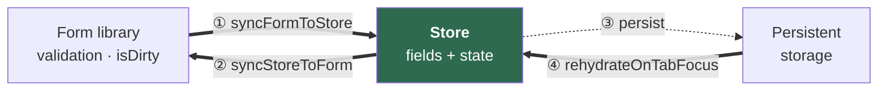
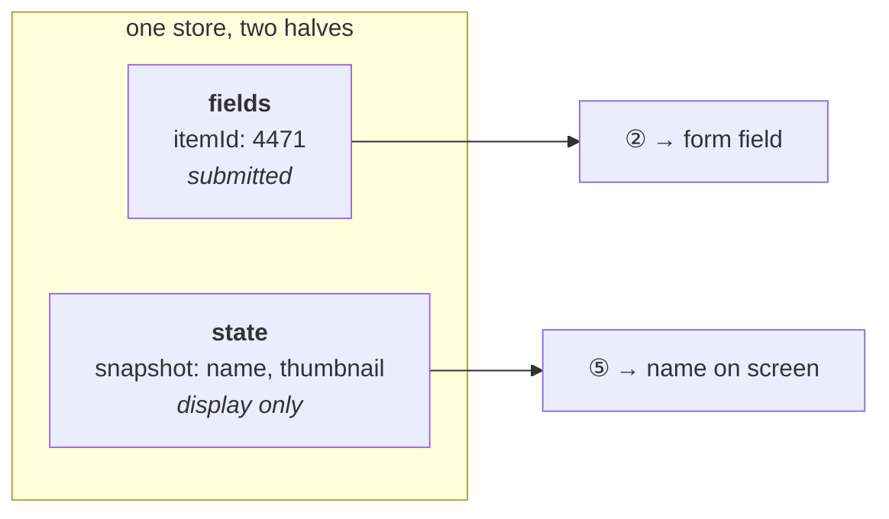
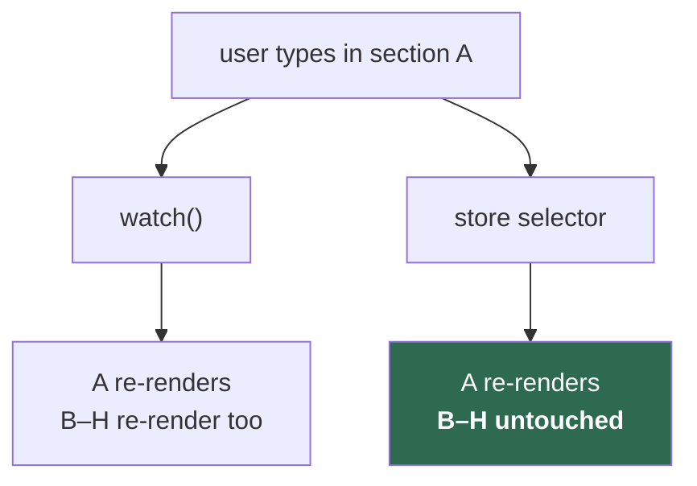

<div align="center">

# Keeping a Form, a Store, and Storage in Sync

**A React draft-persistence pattern that survives a refresh, a dialog, and a second tab.**


</div>

> A long form keeps three parties in sync — the **form library** (input, validation, `isDirty`), a **store** (the fields plus what the form can't hold), and **persistent storage**. Four arrows connect them, and nine silent bugs live in those four arrows. Here's each bug, and the one hook that closes it.



**Thick** arrows are the hook's sync effects (①②④). **Dotted** ③ is the persist middleware — it hydrates the store once at creation and never again, which is why ④ exists. Names match [`reference/create-form-store-helper.ts`](reference/create-form-store-helper.ts).

---

## 🐛 The nine ways it breaks

Each arrow has a failure mode that throws no error.

| # | The trap | What you see | Fix |
|---|---|---|---|
| **1** | Two owners of one value | Infinite loop: form writes store writes form | ①② guard with `deepEqual`, skip unchanged writes |
| **2** | `subscribe` is change-only | Empty form over a valid draft — no change ever fires | ② pulls once by hand at mount |
| **3** | `reset` used as transport | Unsaved-changes warning silently disarmed | Every store→form push keeps `keepDirty` |
| **4** | Storage never announces itself | Second tab stale forever | ④ calls `rehydrate()` on focus |
| **5** | Remote data arrives twice | Focus revalidation destroys in-flight edits | Apply the first server DTO only (`useRef`) |
| **6** | A programmatic write looks like a keystroke | Create page stamps a draft nobody typed | Writes go store-first; create page discards stale drafts |
| **7** | One key, many records | Record #1 bleeds into record #2's form | Opt-in `skipPersist` swaps in noop storage |
| **8** | Store is a module singleton | Two forms fight over `reset` | Dev-only guard, compiled out of prod |
| **9** | Reference ≠ value equality | Identical objects trigger spurious resets | Guards compare by value, not `===` |

> **None throw. Every one ships.**

---

## 🪝 The hook

One hook closes 1, 2, 3, 4, 9; turns 8 into a dev error; offers an opt-in flag for 7. Two layers — the factory runs once per store; the hook it returns runs per mount and *is* the four arrows. Each vertical pair is asymmetric: the downward edge is automatic (① every keystroke, ③ every write), the upward edge must be asked for (② a pull at mount, ④ only when called).

```ts
export const createFormStoreSync = (store: PersistedStore) => {
  const originalStorage = store.persist.getOptions().storage   // read once — see ③
  let activeMountCount = 0                                      // see #8

  return function useFormStoreSync(form: FormApi, { skipPersist = false } = {}) {
    useEffect(suppressPersistStorage, [skipPersist])        // ③ S → P   on/off only
    useEffect(rehydrateOnTabFocus,    [form, skipPersist])  // ④ P → S
    useEffect(syncFormToStore,        [form])               // ① F → S
    useEffect(syncStoreToForm,        [form])               // ② S → F
  }
}
```

<details>
<summary><b>Types the code assumes</b></summary>

```ts
type FormDto = { fields: object; state: object }      // the two halves — see "Why three parties"

type FormApi = {
  getValues(): FormDto['fields']
  reset(values: FormDto['fields'], options?: { keepDirty?: boolean; keepErrors?: boolean }): void
  subscribe(options: { formState: { values: true }; callback: (state: { values: FormDto['fields'] }) => void }): () => void
}

type PersistedStore = StoreApi<FormDto> & {
  persist: {
    rehydrate(): Promise<void>
    getOptions(): { storage: Storage }
    setOptions(options: { storage: Storage }): void
  }
}

declare const deepEqual: (a: unknown, b: unknown) => boolean   // structural — #9 is about `===`
const noopStorage = { getItem: () => null, setItem: () => {}, removeItem: () => {} }
```
</details>

<details>
<summary><b>① <code>syncFormToStore</code> — every keystroke, one way</b></summary>

```ts
function syncFormToStore() {
  return form.subscribe({
    formState: { values: true },
    callback: ({ values }) => {
      // #1 + #9: compare by value against the live store, refuse to write when nothing changed.
      if (deepEqual(values, store.getState().fields)) return
      store.setState(prev => ({ ...prev, fields: values }))
    },
  })
}
```
</details>

<details>
<summary><b>② <code>syncStoreToForm</code> — the mirror, plus one pull by hand</b></summary>

```ts
function syncStoreToForm() {
  const saveToForm = (fields: FormDto['fields']) => {
    if (deepEqual(form.getValues(), fields)) return    // other half of the loop guard
    // #3: reset is transport, not reset. Without keepDirty it disarms the unsaved-changes warning.
    form.reset(fields, { keepDirty: true })
  }
  // #2: subscribe is change-only, and the draft was in the store before React rendered. Pull once.
  saveToForm(store.getState().fields)
  return store.subscribe(state => saveToForm(state.fields))
}
```

Both guards compare **values, not provenance** — neither remembers whose write it was, so the cycle ends after one bounce.
</details>

<details>
<summary><b>③ <code>suppressPersistStorage</code> — the opt-in flag for #7</b></summary>

```ts
function suppressPersistStorage() {
  if (!skipPersist) return
  store.persist.setOptions({ storage: noopStorage })   // ①② keep running; nothing reaches storage
  return () => store.persist.setOptions({ storage: originalStorage })
}
```

`originalStorage` is captured at factory time: read back at cleanup it could be another consumer's noop, stranding the store. This hook must run *before* the initializer in the same component, or `setState(serverData)` writes through while real storage is still attached.
</details>

<details>
<summary><b>④ <code>rehydrateOnTabFocus</code> — the only path up from storage</b></summary>

```ts
function rehydrateOnTabFocus() {
  if (skipPersist) return
  const pull = async () => {
    // #4: the middleware never listens to the cross-document `storage` event. Reading again is deliberate.
    await store.persist.rehydrate()
    form.reset(store.getState().fields, { keepDirty: true, keepErrors: true })
  }
  const onVisible = () => { if (document.visibilityState === 'visible') pull() }
  window.addEventListener('focus', pull)
  document.addEventListener('visibilitychange', onVisible)
  return () => {
    window.removeEventListener('focus', pull)
    document.removeEventListener('visibilitychange', onVisible)
  }
}
```

The `reset` here is mostly a second pass — `rehydrate()` already fired ②'s reset synchronously, just without `keepErrors`. Move `keepErrors` into ② and this line goes away.
</details>

<details>
<summary><b>#8 — a dev-time guard, not a fix</b></summary>

The store is a singleton, so two consumers both call `form.reset` on it. The hook can't prevent it, only make it loud — a fifth effect, dev builds only:

```ts
function assertSingleConsumer() {
  activeMountCount += 1
  if (activeMountCount > 1) {
    console.error('Two mounted consumers will fight over form.reset. Mount once per store, or share via context.')
  }
  return () => { activeMountCount -= 1 }
}
```

Selected against a no-op by `NODE_ENV` at module load, so it leaves the prod bundle entirely.
</details>

<details>
<summary><b>#5 and #6 — the initializer's job, not the sync's</b></summary>

- **#5 · Remote data arrives twice.** The init hook applies the first non-`undefined` server DTO and ignores later ones (`useRef`). Otherwise SWR's `revalidateOnFocus` returns a fresh object, `setState(dto, true)` replaces the store, and edits are gone. The flag is per mount — key the page by record id so a reused page doesn't show the wrong record.
- **#6 · Programmatic writes look like keystrokes.** ① can't tell `form.reset(data)` from typing. So programmatic writes go store-first: ② delivers them, ① sees equal values and stays silent, and a branded reset type makes the raw one a compile error. The create page also discards any persisted leftover from an edit session.
</details>

---

## 💸 What it cost

Difficulty 7, in the field. Twenty forms used the hook. Twelve persisted to per-tab `sessionStorage`, out of reach. The other eight shared one `localStorage` key behind `/record/:id/edit` and each had to pass the opt-in flag.

**Five passed it. Three didn't.** It compiled (the option is optional), passed review (a missing argument is invisible), and worked in every single-tab test (the bug needs two tabs on two records). The flag also has a hidden price: a form that passes it keeps no draft — so the draft requirement is forfeited for the five that pass, and the three that skip it keep the bug.

> **A correctness property that depends on every call site opting in will be violated in proportion to the number of call sites.**

Make suppression structural — decided by the factory, not the page — and the flag, its ordering contract, and all three bugs vanish at once.

---

## 🧱 Why three parties

Keep it all in the form library — until eight requirements force a store, then persistence:

| # | Requirement | Met by |
|---|---|---|
| 1 | A draft survives two days away | **persistence** |
| 2 | A dialog outside the form writes a field | store |
| 3 | The form shows the name of an item that no longer exists | store |
| 4 | Four dependent values change in one tick | store |
| 5 | One section re-renders, not the other seven | store |
| 6 | Fields stay locked to the server's original answer | store |
| 7 | A second tab edits the same record | **persistence** |
| 8 | The unsaved-changes warning survives a dialog edit | form |

**Only 1 and 7 need persistence.** The store earns its place through what components *read* from it: snapshots that outlive their option list (3, 4), the server's original answer (6), per-value subscriptions (5). Its job is less "mirror the form" than "hold what the form has no room for."

<details>
<summary><b>Two halves: <code>fields</code> vs <code>state</code></b></summary>

`fields` is submitted; `state` is display and bookkeeping (a deleted item's name, a parent snapshot, the original status).



One `setState` writes all four dependent values in the same tick, so form (②) and screen (⑤) update together — no frame with the old child's name beside the new parent's id.
</details>

<details>
<summary><b>Reading one value without re-rendering the rest</b></summary>



`watch()` re-renders the whole subtree; a selector fires only for its value. The same selector locks #6: it reads `state.initialStatus`, which the user's toggle never touches.
</details>

### 👩‍💻 Alice's empty form

[`reference/alice-empty-form.tsx`](reference/alice-empty-form.tsx) shows difficulty 2 as a story in code.

| Before | After | Fix |
|---|---|---|
| Alice spends twenty minutes on a campaign, refreshes, and every field is blank. | Alice refreshes; everything she typed is still there. | Keystrokes are copied to the store and saved in the browser. On refresh the store reloads before the form appears — but the form starts empty and only copies on *change*, which never fires. So `syncStoreToForm` copies the store in once at mount, then waits. |

That one-time copy looks redundant in review, so it lives once in the module instead of in every form.

---

## 📁 Files

| File | What it does |
|---|---|
| `README.md` | This document |
| [`reference/create-form-store-helper.ts`](reference/create-form-store-helper.ts) | The module: `createUsePersistFormStoreSync` returns the sync hook; `createUseInitPersistForm` returns a hook that decides once what the store starts with (server record, saved draft, or defaults) |
| [`reference/alice-empty-form.tsx`](reference/alice-empty-form.tsx) | [Alice's empty form](#-alices-empty-form) as code: the hand-written version and its fix |
| `LICENSE` | The license |
